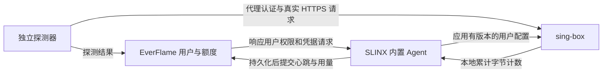

# SLINX-EF 与 EverFlame 状态、流量及用户同步调研

日期：2026-11-08（Asia/Shanghai）。状态：方案，尚未实施。

## 结论

建议保留 EverFlame（SSPanel-UIM）和 SLINX-EF，在 SLINX 中完善一个轻量的 EverFlame Agent：**节点主动推送心跳、健康结果和逐用户流量，节点主动拉取用户、凭据及额度；由独立探测器验证真实代理链路。** 所有管理通信可由节点向面板发起 HTTPS 请求，无需让面板访问节点管理端口。

这借鉴机场后端常用的“拉用户、报用量”模式，但需要补齐当前代码缺失的身份映射、可靠入账和健康语义。只打开已有“面板对接”开关，无法解决当前两条 Shadowsocks 线路的问题。

当前规模不需要引入消息队列、长连接控制平台或更换整套机场面板。优先将 Agent 集成在现有 SLINX 进程中，复用数据库、入站、路由和核心管理器。

## 1. 调研范围与实证

本次读取了两个本地项目源码、现有部署/验收文档、运行中的 EverFlame 数据库，并查阅上游源码、官方文档及后端项目当前状态。数据库检查仅 SELECT；没有调用会写心跳的用户同步接口，没有调整节点、凭据或线上服务。

当前 VPS 的 SSH、sing-box 统计接口和两条线路没有重新实测；文档中的既往连通性结果只能作为背景，不代表此刻状态。SLINX 本地 Git 元数据存在 `packed-refs` 解析异常，本报告按工作目录源码审计，不将其未经核实地等同于线上二进制。

### 1.1 黄点的直接原因已确认

运行库查询结果：

| 节点 ID | 名称 | 所属面板用户 | node_heartbeat | node_bandwidth |
| --- | --- | --- | --- | --- |
| 1 | 香港 01 | 1 | 0 | 0 |
| 2 | 新加坡 01 | 1 | 0 | 0 |
| 3 | 香港 01 | 2 | 0 | 0 |
| 4 | 新加坡 01 | 2 | 0 | 0 |

两位用户的 `u/d/transfer_total/transfer_today` 均为 0；各有 322122547200 字节额度（面板 300G）；`hourly_usage` 为 0 行，`traffic_log` 已开启。

`src/Models/Node.php:55` 和 `:113` 的现有规则是：

- 心跳从未上报（0）→ orange，即当前看到的黄点。
- 心跳距今小于 600 秒 → green。
- 曾上报但超过 600 秒 → red。

`src/Controllers/WebAPI/UserController.php:44` 在节点请求 `GET /mod_mu/users` 时更新心跳。这个请求在检查核心是否运行、认证是否成功、上游出口是否可用之前就会影响颜色。因此**即便成功变绿，也只证明控制通信曾发生**。

### 1.2 现在导入的是连接资料，没有建立持续控制和计量关系

`scripts/import-slinx.php` 把导出中的服务器、端口、加密方式和密码写入 `custom_config.external_shadowsocks`，并通过 `owner_user_id` 隔离面板可见性。它不建立 SLINX 用户与 EverFlame 用户之间的持续映射。

运行库仅在内存中比较凭据，确认：节点 1 与 3 的密码相同，节点 2 与 4 的密码相同；未输出密码或其哈希。也就是说，两个面板账号对应同一个源 SLINX 身份，服务端无法仅凭这些连接识别其面板账号。

因此，现阶段不能把源用户的流量同时写给两个面板账号，也不能靠访问来源 IP 拆分归属。已有共享身份产生的历史流量无法可靠追溯为逐账号用量。

### 1.3 SLINX 已有对接雏形，但当前 SS 路径不能直接用

已有路径：

```text
BoardEnable
  → internal/sync/sync.go
  → internal/sync/slinx/slinx.go
      GET  /mod_mu/users
      本地 sing-box gRPC QueryStats
      POST /mod_mu/users/traffic
      POST /mod_mu/users/aliveip
```

界面类型名虽然是 `SLINX`，请求实际使用 SSPanel `/mod_mu` 风格。它可作为改造基础，但存在以下具体问题：

| 问题 | 代码证据 | 后果 |
| --- | --- | --- |
| SS 明确拒绝外部面板用户 | `SLINX-EF/internal/core/config.go` 的 SS 分支遇到 `boardUsers` 直接返回错误 | 当前香港/新加坡 SS 入站无法靠启用 Board 接入 |
| 只认 `BoardUser_<uid>` 流量 | `internal/sync/slinx/slinx.go` 的 `reportTraffic` | 现有本地用户即便产生统计，也不会自动映射到 EverFlame |
| 身份不含面板/绑定/入站命名空间 | `internal/core/config.go` 的 `buildUsers` | 相同用户 ID 跨绑定聚合，不能可靠区分线路 |
| 每个 Board 各自读取全局统计并清零 | `internal/core/traffic.go` 的 `Reset_: true`；`internal/sync/sync.go` 每绑定启动同步任务 | 第一个读取者消耗全局计数，其他绑定漏报或归错节点 |
| HTTP POST 不检查错误、状态码、业务返回，也不关闭响应体 | `reportTraffic`、`reportAliveIP` | 失败仍记录为已上报，无法可靠补报，并有连接资源问题 |
| 拉用户失败直接退出整轮同步 | `Sync` 开头 | 控制接口失败会阻断后续采集、上报；应解耦任务 |
| 用户变化先 Apply，错误未处理 | `Sync`；`Manager.Apply` 会重启运行中的核心 | 可能显示同步完成但配置未应用；重启前未结算计数 |
| 在线 IP 依赖最近一分钟日志与活动来源 IP 关联 | `internal/core/connections.go` | 长连接、日志轮转及共用 NAT 场景会漏算或误认，不能用于计费 |
| 仪表盘历史统计来自整机网卡 | `internal/job/stats.go` 的 `net.IOCounters(false)` | 包含其他服务及中转流量，不能作为用户账单 |

另外，当前 `QueryStatsRequest.Pattern` 是旧字段。官方 1.13.12 的处理逻辑以 `Patterns` 过滤；新的采集器应使用对应固定核心实际支持的请求，并严格校验 `user>>>` 前缀，避免新增入站/出站统计后误读其他计数。应通过真实 gRPC 集成测试确认，不能只根据生成的服务常量判断兼容性。[固定版本统计源码](https://raw.githubusercontent.com/SagerNet/sing-box/v1.13.12/experimental/v2rayapi/stats.go)

### 1.4 面板接收端也需要补齐

- `src/Middleware/NodeToken.php:47` 将 Host 固定拼为 `https://`，而运行配置的 API 地址是 `http`。现配置下旧 WebAPI 校验无法通过；此前订阅入口的修复不包含此中间件。
- 面板容器仅发布到 `127.0.0.1:18087`，VPS 不能直接访问开发机的 localhost。
- 当前 `checkNodeIp=true`；导入器未同步节点管理通信 IP。现有校验也是“任一节点 IP 匹配”，不是针对请求绑定的精确授权。
- `/mod_mu` 当前实际使用全局 `muKey`；节点表虽有 `password` 字段，不能据此假设旧路由已使用逐节点密钥。
- `addTraffic` 接收的是增量，逐条读取旧值再写回，没有请求幂等标识，也未把整批账目放在同一事务中。直接重试可能重复扣量，并发上报可能覆盖更新，部分失败可能产生半批入账。
- `online_user = count(data) - 1` 计算的是流量记录数而非在线用户数，应独立修正，不能照抄到新接口。
- `hourly_usage` 只有用户/日期/24 小时合计，没有逐节点及上传下载拆分；且按收到请求的当前小时入账，补报会错位。
- `app/routes.php` 中 `/node/api/v1` 整组被注释，对应控制器为空，不能把它当作现成新版 API 使用。

## 2. 推送与拉取如何选择

| 方案 | 优点 | 局限 | 对当前项目的判断 |
| --- | --- | --- | --- |
| SLINX 主动上报状态/用量 | 本地有原始数据；易做持久化重试；无需公开节点管理接口 | 必须实现幂等、重试、过期判定 | **推荐作为状态和账目的主通道** |
| 面板定时访问 SLINX API | 集中调度，节点失联直观 | 面板须能访问各节点；需保管节点管理凭据；直接读取会清零的统计尤其危险 | 不作为计费主通道；专用只读快照可用于诊断 |
| 节点拉用户、推用量 + 独立探测 | 控制与数据归属清楚，贴合现有源码；可分别恢复故障 | 要设计身份、配置版本及健康状态 | **最适合本项目** |
| 节点建立 WebSocket/gRPC 长连接 | 可以即时下发配置，减少轮询延迟 | 重连、会话恢复、代理超时及顺序处理复杂；仍需账目持久化和幂等 | 节点和用户规模扩大后再考虑 |
| Prometheus 拉 metrics + Grafana | 适合服务器资源、趋势及告警 | 不能解决共享凭据、额度、业务入账原子性 | 可选运维补充 |
| 节点直连面板数据库 | 少一层 API | 数据库权限扩散、耦合表结构及计费逻辑 | 不采用 |

“推送/拉取”本身不决定流量准确性。**不清零累计计数、本地持久化、稳定身份、事务与去重**才决定能否正确记账；即便选择面板拉取，也需要这些能力。

这里的“混合”指业务消息的分工：用户权限由节点请求，测量数据由节点提交。两类网络连接都可由 SLINX 向 EverFlame 发起。

## 3. 社区方案的适用性

| 方案/项目 | 已核对的事实 | 如何借鉴 |
| --- | --- | --- |
| SLINX 上游 | 本身已有拉用户、报流量/IP 的实现 | 复用结构，修复上述缺陷；无需再叠加一套管理核心。[上游代码](https://raw.githubusercontent.com/slinxlink/node/main/internal/sync/slinx/slinx.go) |
| SSPanel WebAPI / XrayR 历史实现 | XrayR v0.9.4 使用 GET 拉取配置/用户、POST 上报流量/IP | 借鉴协议分工；XrayR 当前官方仓库标明项目废弃，不作为新部署首选。[历史 API 实现](https://raw.githubusercontent.com/XrayR-project/XrayR/v0.9.4/api/sspanel/sspanel.go)、[当前仓库](https://github.com/XrayR-project/XrayR) |
| V2bX | InazumaV 原仓库已归档；wyx2685 分支也已归档。所查新分支声明适配 XBoard/V2Board/UniProxy，不能直接据此认定兼容当前 SSPanel | 可评估替换后端的独立路线；此时需要迁移核心所有权及既有路由，不能与 SLINX 同时管理同一端口。[原仓库](https://github.com/InazumaV/V2bX)、[wyx2685](https://github.com/wyx2685/V2bX)、[新分支说明](https://github.com/Sakawat-hossain/V2bX) |
| Soga | 官方功能表列出 SSPanel-UIM 的 SS 支持、用户限速、在线限制及 API 对接；不同面板的协议支持不同 | 如果以后要换成专用机场后端，可做候选验证。它是另一套数据面，不是给 SLINX 加一个上报插件；现有 SSH/ISP 链路兼容性须实测。[官方能力表](https://www.yougotme.cc/soga/) |
| Prometheus / blackbox_exporter | 可监控资源及 HTTP/TCP/DNS 等探测；Pushgateway 官方不建议泛化用于常驻实例监控 | 借鉴独立健康探测，普通 TCP 成功不能代替 SS 认证与实际转发；无需为两条线路先部署整套系统。[探测器](https://github.com/prometheus/blackbox_exporter)、[Pushgateway 边界](https://prometheus.io/docs/practices/pushing/) |

目前没有证据支持存在一个可直接无缝安装、同时适配本项目 SS 凭据导入、既有 ISP 路由和可靠计费的社区插件。上表的适配建议是结合源码作出的工程判断，不代表完成这些替代产品的部署验证。

## 4. 推荐架构与职责



EverFlame 负责用户、套餐、授权、周期、倍率和最终账目；SLINX 负责本机核心、入站、出口及路由。用户身份和额度以 EverFlame 为准，避免两边同时编辑同一受管用户。SLINX 原有独立本地用户仍可保留，但必须单独标识为非机场受管身份。

初期在现有项目内增加 Agent 和小型专用 API，不建立通用多机调度平台。可以保留 `/mod_mu` 的其他使用者，新链路使用有版本的接口，避免在旧增量接口上悄悄改变计费语义。

### 4.1 先统一线路与用户身份

区分四种对象：物理服务器、入站、面板展示的线路、面板用户。当前 4 条记录实际表达两条线路和两位用户，不能把它们当作 4 台独立服务器。

- 每个 SLINX 实例有持久化 `agent_id`。
- 每条对外线路有稳定 `binding_id`，绑定 SLINX 入站及对应面板节点。
- 每位用户拥有独立代理凭据，绑定 `(panel_instance, user_id, binding_id)`。禁止继续把同一源身份复制给多个面板用户。
- sing-box 统计用户名建议采用 `ef:<panel_instance>:<binding_id>:<user_id>`，不要包含 `>>>` 分隔符。这样按用户统计即可区分线路，避免全局同名统计混合。
- 复用现有 SS 多用户能力，补上外部用户生成和对应订阅导出。受管凭据由面板生成/保存并下发，核心与订阅共用同一结果；不要让两端独立猜测派生方式。
- 当前 native SS 导出默认取用户端口，不能直接套用为“一个入站端口多用户”。需要明确增加受管线路端口/密码解析，沿用共享的凭据解析层覆盖各订阅格式。
- 本期优先完成现用 AEAD Shadowsocks，不为接通同步被迫更换代理协议。

推荐最终一条共享线路对应一条面板节点，凭据逐用户保存。迁移阶段可先保留现有 owner 隔离的展示记录，但其健康来自同一个绑定，用量只按真实用户和绑定记一次。旧节点 ID 到新绑定应有明确迁移表，不能按名称模糊匹配。

### 4.2 让绿色真正表示近期代理链路可用

分别保存：`agent_last_seen`、`core_status`、`config_revision_applied`、`inbound_status`、`egress_probe`、`external_probe`。健康与流量补报互不阻塞；旧的缓存心跳不能被补报成当前在线。

建议用户卡片主点采用以下语义，详情展示故障层级、探测位置及时间：

| 颜色 | 建议含义 |
| --- | --- |
| 绿 | Agent 新鲜、核心/配置正常，指定线路最近的代理认证和真实转发探测成功 |
| 黄 | 尚未探测、结果过期、计量故障或只有节点自检而缺少所需外部证据 |
| 红 | 在规定观察点连续探测失败，或 Agent 超过失联阈值；明确标注原因 |

初始参数建议：心跳 30 秒、90 秒未收到即标记控制链路失联；每条线路外部探测 60 秒一次，超时 5–10 秒，连续 3 次失败判不可用，连续 2 次成功恢复。参数是建议值，探测频率与结果有效期要一起配置。

探测应由 SLINX 所在主机之外发起，以专用探测凭据连接真实 SS 公网地址/端口，走与用户相同的路由和上游，访问两个不同来源的小型 HTTPS 目标，校验证书和预期响应，必要时核对出口 IP。一个目标故障不直接判整条线路故障；目标站 403/429 不等同代理传输故障。

本机 `internal/core/probe.go` 已能启动指定出站链的隔离测试核心，可复用为出口自检。但该测试绕过生产公网入站，不能独自证明外部用户可连接。外部探测只证明该观察点的路径；有大陆可用性要求时需增加相应观察点。探测身份的字节不计入付费用户额度。

既往验收记录曾显示香港可用、新加坡 SSH 上游认证失败；新的健康机制应能出现“Agent 在线、新加坡线路不可用”，不会因同一台机器仍活着而让两条线路一起变绿。这里未宣称已重新验证该故障仍存在。

### 4.3 可靠流量链路

读取 sing-box V2Ray API 的逐用户原始累计字节。官方文档明确支持用户/入站/出站统计，但要求构建包含相应 API；部署验收要检查实际运行二进制能力。[官方文档](https://sing-box.sagernet.org/configuration/experimental/v2ray-api/)

推荐流程：

1. **单一采集器**每 1–5 秒读取所有受管用户，使用不清零的计数；禁止每个 Board 独立消费全局计数。
2. 根据持久化 `core_epoch` 和上次读数计算增量，将新 checkpoint 与待发送事件在同一 SQLite 事务中保存。计数回退必须识别为新 epoch 或异常，不能生成负流量。
3. 每 30 秒将待发事件批量提交面板。持久化事件包含 `agent_id/binding_id/user_id/core_epoch/seq/interval_start/interval_end/raw_u/raw_d`；序列和事件内容生成后不可变，字节使用整数。
4. 面板按唯一事件标识去重，校验 Agent 仅能报告授权绑定与用户；同一标识不同内容应拒绝。验证整批输入后，在事务内写事件、原始用量、倍率账目及小时汇总，并用行锁或原子增量避免并发覆盖。
5. 数据库提交成功后才 ACK；SLINX 收到 ACK 后才清理本地待发事件。超时、5xx、响应丢失按同一事件重试，已接收事件返回原确认结果，避免再扣一次。
6. 采集、用户拉取、健康心跳与发送任务相互独立。发送失败不停止本地采集，配置失败不删除尚未结算的用户及其账目。

这里实现的是**已持久化用量的至少一次发送和幂等入账**。单靠外部轮询无法保证核心突然崩溃前最后一小段内存计数绝不丢失：应在受控重启前停止接收新流量、结算和落盘，再切换 epoch；非受控崩溃记录采集缺口，不能声称绝对零损失。若未来有严格结算要求，需要进一步改造核心计量持久化或采用经验证的专用数据面。

不采用“清零计数 → HTTP POST”的现有顺序；失败后的数值已无法重新从核心读取。也不把网卡流量、客户端上传量、活动连接快照或日志采样作为用户计费依据。

### 4.4 保留三种流量口径

| 口径 | 含义与用途 |
| --- | --- |
| 原始代理用量 | 用户经代理实际转发的上/下行应用数据；核心计数，按用户和线路保存 |
| 扣额用量 | 原始用量乘面板约定倍率，更新账户额度；倍率只在面板应用一次 |
| 服务器/供应商用量 | 网卡、封装、重传、中继及供应商口径；用于成本/容量，与用户账面不会严格相等 |

新历史记录保留原始上/下行、绑定、发生时间和费率版本，现有 `hourly_usage` 可暂作兼容汇总。动态倍率依据用量发生时间和当时有效规则计算，不按补报时间重新套费率。

跨小时数据应在采集时分桶；跨月补报依据发生周期入历史账本，旧周期用量不能扣新月额度。月度重置与入账必须协调锁和周期状态。采样跨越边界存在小段时间归属误差时应明确规则，不能用到达时间覆盖它。

### 4.5 额度和到期控制形成闭环

仅有流量图表还不等于 300G 额度真正生效。节点需收到用户到期时间、计费周期、可用额度和凭据修订号，在本地按用户汇总香港/新加坡两条线路的用量，到期或耗尽后拒绝新连接，并处理已有长连接。

当前一台 SLINX 管理两条线路，可用单一额度执行器共享扣减。若以后多个独立 Agent 共用账号，不能每台都独立拿完整剩余额度使用；需要预分配预算/租约，或明确接受同步延迟导致的超额上限。

面板暂时离线时，本地继续采集并保存事件，使用未到期的已缓存授权和剩余预算；预算或授权租约耗尽后拒绝新增使用。恢复后先补报、对账并取得新周期/配置，再继续发放预算。不能把远端错误解释为空用户列表，静默清空有效配置。

## 5. 最小接口与存储建议

以下均为建议新增接口，当前项目尚不存在：

| 接口 | 方向与内容 |
| --- | --- |
| `GET /api/ef/v1/desired-state` | Agent 拉取自己获准管理的线路、用户、凭据、额度、期限及配置版本，支持 ETag |
| `POST /api/ef/v1/heartbeat` | Agent 提交核心状态、已应用版本、绑定状态、采集错误及本机自检；独立于账目队列 |
| `POST /api/ef/v1/usage` | 提交不可变用量事件，返回持久化 ACK 和必要的额度/版本信息 |

线路身份可在首次注册/绑定时交换，后续仅在公开入口参数变化时更新；不需要频繁同步整个 SLINX 配置。专用观察器用独立受限身份写探测结果。

所需逻辑数据包括 Agent 授权、线路绑定、逐用户凭据、用量事件及 checkpoint、当前健康快照。可复用现有节点表与 SLINX SQLite；具体表拆分以迁移设计决定，无需另建时序数据库。补报队列需设置磁盘水位监控，磁盘满时进入明确故障状态，不能静默丢弃账目。

新 API 使用逐 Agent 的可轮换 Bearer Token（服务端保存校验摘要），绑定允许的线路；只通过 HTTPS 或受控管理隧道访问。统计 gRPC 和 Clash API 继续只监听 localhost，避免公开 2048/9090，也不复用管理员登录凭据。

当前本地面板应先通过 WireGuard/Tailscale 等管理网或受控隧道使节点可达；现有 loopback 发布无需直接改为全网开放。最终生产部署再使用稳定 HTTPS 域名。主机/协议校验需兼容可信反向代理，不能简单删除认证校验或盲信转发头。

## 6. 分阶段实施与验收

| 阶段 | 工作 | 完成标志 |
| --- | --- | --- |
| P0：链路与健康 | 打通受限管理通道；绑定两条真实线路；增加独立心跳、真实代理探测及清晰颜色 | 没流量也能判在线；停核心、停 Agent、上游认证失败分别能定位；不会所有线路一起假绿 |
| P1：身份与影子计量 | 给两位测试账号分配不同 SS 身份，补齐核心/订阅；实现单采集器、outbox、幂等接收 | 两账号并发连接能分开统计；同一账号两线路能分开归属；先记录影子账目再核对 |
| P2：扣量闭环 | 启用面板原子入账、历史分桶、周期和费率，增加本地额度/到期处理 | 实际使用后余额减少；断网补报不重复；跨月补报不扣错周期；耗尽/到期实际失效 |
| P3：迁移与固化 | 合并线路展示模型、撤销旧共享身份、灰度升级和回滚、必要的资源告警 | 旧共享凭据不再绕过额度；新旧路径不会双报；固定核心与发布版本验收完整 |

可以先交付 P0 解决“看不到真实状态”，但需明确流量计费仍待 P1/P2。完整方案必须把独立用户身份、可靠入账和额度执行一起交付。

重点验收案例：

1. 两账号各自上传/下载已知数据，TCP/UDP 分开验证；以相同核心统计口径对账，不要求网卡值精确等于测试文件大小。
2. 同一账号同时使用香港/新加坡，账目总计等于两条线路之和，不能串线、漏掉短连接或重复记中转流量。
3. 面板已提交数据库但响应丢失，重传同一批次后只扣一次；多线路并发提交也不覆盖余额。
4. 面板不可达、Agent 重启、核心受控/异常重启，分别检查 outbox、epoch、补报与采集缺口；旧配置/待报用户不会被提前删除。
5. 在月末、倍率切换和用户禁用前后产生流量，再延迟上报，账期与费率正确。
6. 健康请求必须走指定线路；错误 SS 密码、入口不可达、上游 SSH 认证失败不能返回绿色或改走 Direct。
7. 小额度耗尽、账号到期及停用后，新连接与已有长连接按约定失效；剩余额度不能因删除订阅或停止刷新而绕过。
8. 灰度只迁一个测试身份和一条线路，确认后扩展；保留原配置备份。回滚时保留计费事件和待发队列，避免丢账或重新开放旧共享凭据。

## 7. 需要改动的代码范围

EverFlame：

- 新增受限 Agent API、中间件和绑定/凭据/用量模型，接入 `app/routes.php`。
- 在共享的 `ShadowsocksCredentials` 解析层增加受管逐用户模式，各订阅导出器共用，避免不同格式密码不一致。
- 增加统一入账服务，与月度重置协调；管理接口、旧 WebAPI 如继续使用，不能与新路径对同一用量同时记账。
- 更新节点健康计算、卡片故障说明及流量历史查询，复用既有页面。

SLINX-EF：

- 完善 `internal/sync` 或新增 `internal/agent`，将拉配置、采集、发送、心跳拆成独立可取消任务，避免旧任务重启后并行消费。
- 更新 `internal/core/config.go` 的外部 SS 用户及统计命名空间；核对固定核心 gRPC 协议和构建标签。
- 替换 `internal/core/traffic.go` 的清零采集，新增 SQLite checkpoint/outbox。
- 在 `internal/core/manager.go` 配置变更和重启前后做结算与 epoch 管理，检查 Apply 真实结果。
- 增加受管用户额度/到期执行及必要的连接终止能力；未知在线人数显示未知，不使用日志猜测代替准确结果。

本轮交付为调研与可实施方案；未将现有黄点改为绿色，未改凭据、路由、扣量或数据库结构。
